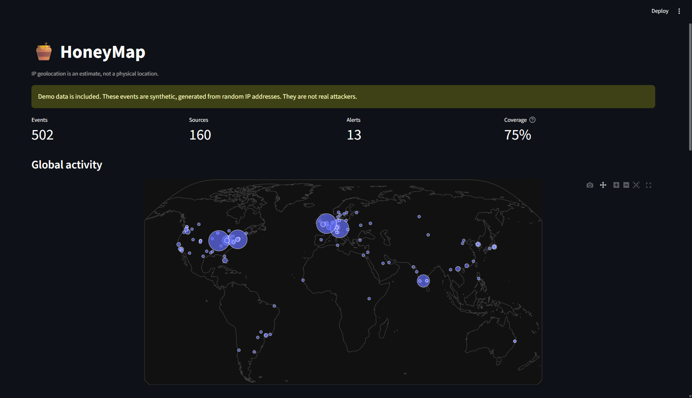
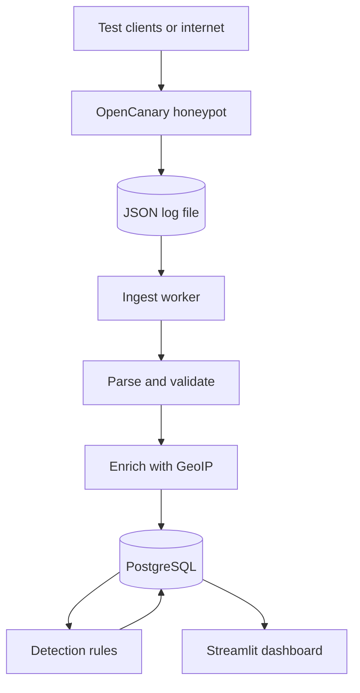
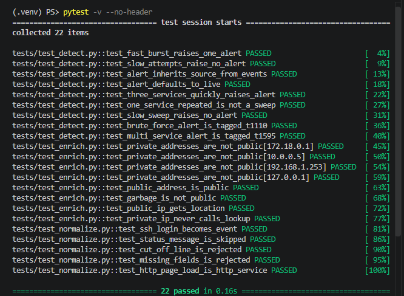
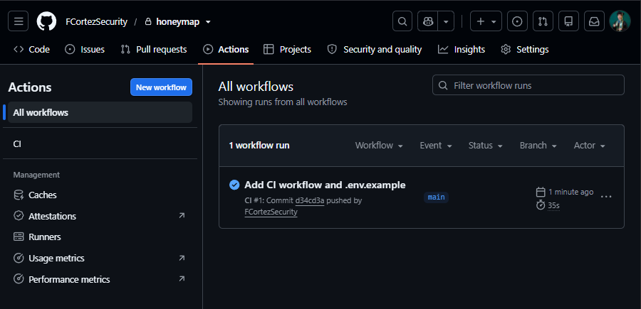
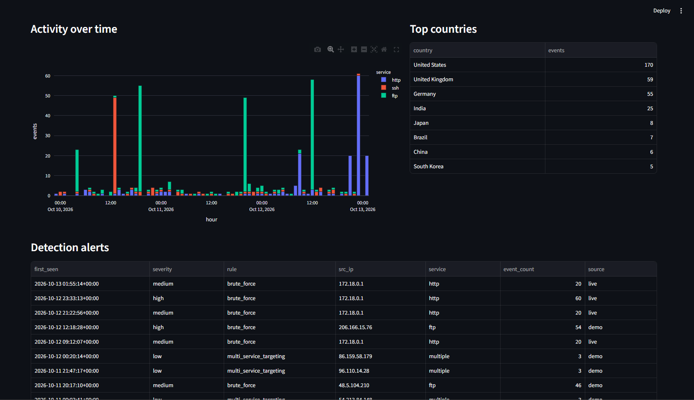
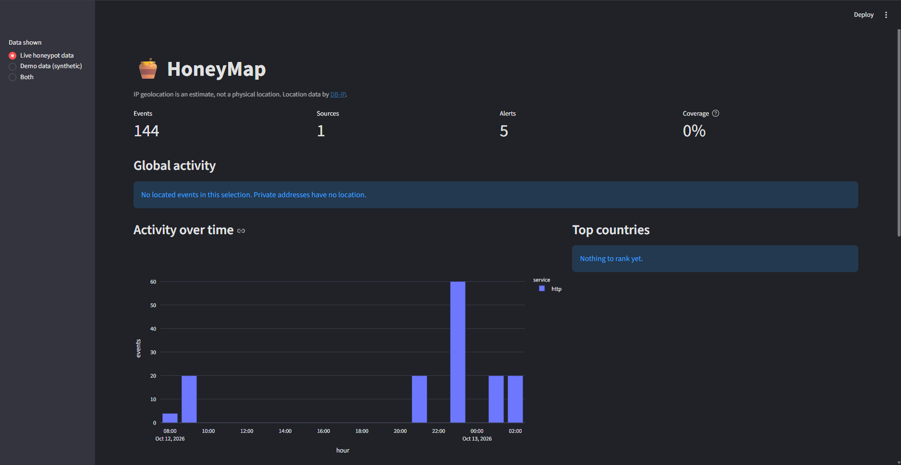
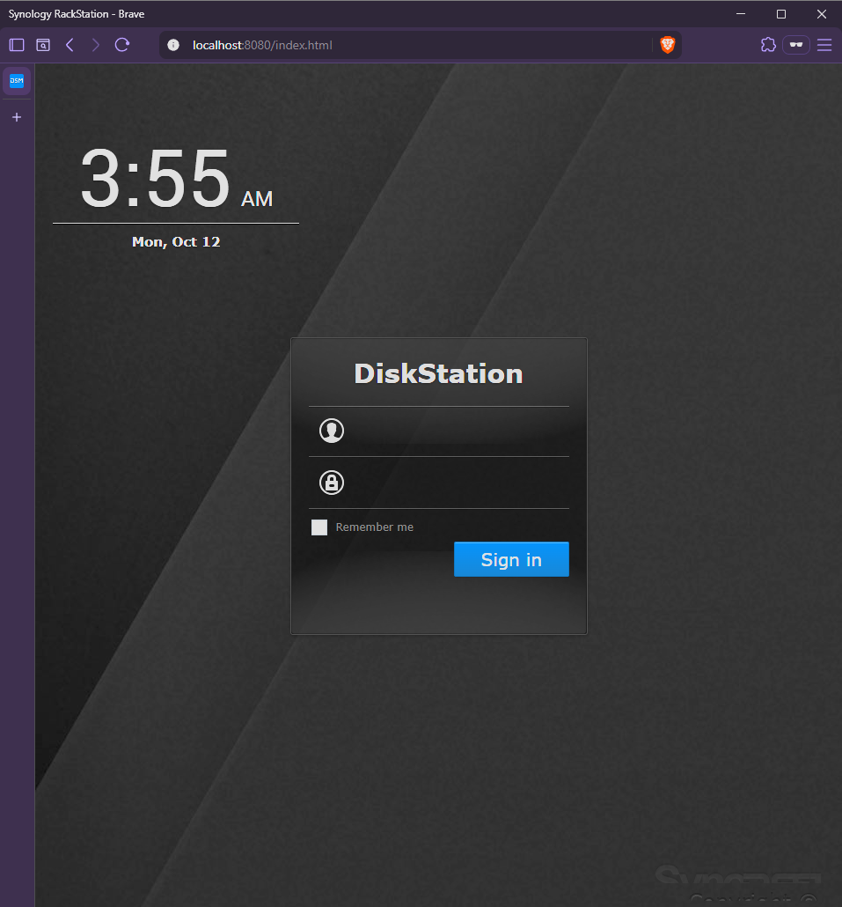

# 🍯 HoneyMap


A honeypot threat-intelligence pipeline. Decoy services collect hostile traffic, a Python worker parses and enriches each event with location and network data, detection rules raise alerts, and a Streamlit dashboard shows everything on a world map. The whole stack starts with one `docker compose` command.



*The dashboard in demo mode. The banner appears whenever synthetic data is on screen, and the map points are estimates, not physical locations.*

> **About the data in the screenshots.** The world map is filled with **synthetic demo data** generated from random public IP addresses. It is not real attackers. Every event and alert carries a `live` or `demo` label, and the dashboard can show either or both. The only `live` traffic so far is my own test traffic from my machine, which has no map location. See [Limitations](#limitations).

## Goals

1. Run a real honeypot (OpenCanary) that logs SSH, HTTP and FTP interaction as structured events.
2. Turn raw log lines into clean, typed records, and survive the messy ones without crashing.
3. Enrich each public source IP with country, city, coordinates and network owner (ASN), and skip addresses that have no location.
4. Detect common attack patterns with explainable rules, and keep one alert per incident instead of one per log line.
5. Store events and alerts in PostgreSQL and show them on an interactive dashboard.
6. Be honest about the data: keep synthetic demo data clearly separate from real honeypot data.
7. Make the project reproducible: tests, CI on every push, and a one-command Docker deployment.

## What it does

| Part | Role | Tech |
|---|---|---|
| Honeypot | Fake SSH, HTTP (a NAS login page) and FTP services that log every interaction as one JSON line | OpenCanary |
| Parser | Turns a log line into a typed `Event`, skips OpenCanary's own status lines, rejects malformed lines without crashing | Python |
| Enrichment | Country, city, coordinates, ASN and organization for public IPs. Private addresses are skipped | DB-IP Lite, geoip2 |
| Detection | Rules that turn events into alerts | Python |
| Storage | Events and alerts, with database constraints that block duplicates | PostgreSQL |
| Dashboard | Metrics, world map, timeline, top countries, alerts, recent events, live/demo filter | Streamlit, Plotly |
| Delivery | One command starts honeypot, database, ingest worker and dashboard | Docker Compose |
| Quality | 22 unit tests, tests run on every push | pytest, GitHub Actions |

## How it works



1. **Honeypot.** OpenCanary listens on three decoy ports and appends one JSON line per event to a shared log file.
2. **Parse.** Each line becomes an `Event` (time in UTC, source IP and port, destination port, service, event type, username, password). OpenCanary's internal status messages (log types 1000 to 1099) are skipped. Bad lines raise a `ParseError` and are counted, not fatal.
3. **Enrich.** Public IPs get country, city, latitude, longitude, ASN and organization. Private and reserved addresses (like Docker's `172.18.0.1`) are never looked up, so nothing gets a fake location.
4. **Store.** Events go into PostgreSQL. A `UNIQUE` constraint means re-reading the same log line never creates a duplicate row.
5. **Detect.** After every batch, all rules run over the stored events and write alerts. Alerts also have a `UNIQUE` constraint, and an alert for an ongoing attack is updated as it grows.
6. **Show.** The dashboard queries the database each time the page loads.

The ingest worker remembers a byte offset in the log file, so each cycle reads only the lines added since the last one. It leaves a half-written last line for the next cycle.

## Detection rules

| Rule | MITRE ATT&CK | Fires when | Severity |
|---|---|---|---|
| `brute_force` | [T1110](https://attack.mitre.org/techniques/T1110/) Brute Force | 10 or more login attempts from one IP against one service within 5 minutes of the burst's first attempt | medium, high at 50 or more |
| `multi_service_targeting` | [T1595](https://attack.mitre.org/techniques/T1595/) Active Scanning | one IP touches 3 or more different services within 30 minutes | low |

Only `login_attempt` events count toward brute force, so someone loading the login page ten times does not trigger it. A sustained attack is **one alert that grows**, not hundreds of rows. Thresholds are function arguments in `src/honeymap/detect.py`.

## Quick start

Windows PowerShell shown. On macOS or Linux, use `cp` instead of `copy` and `source .venv/bin/activate`.

Requires Docker and Python 3.10 or newer (developed on 3.14, containers and CI use 3.12).

```powershell
git clone https://github.com/FCortezSecurity/honeymap.git
cd honeymap
copy .env.example .env             # then open .env and set your own database password
python -m venv .venv
.\.venv\Scripts\Activate.ps1
pip install -r requirements.txt
python scripts/download_geoip.py   # free DB-IP Lite databases, about 100 MB
docker compose up -d --build
```

The dashboard is at **http://localhost:8501** and starts empty. The database tables are created automatically on first start.

Load synthetic demo data:

```powershell
python scripts/make_demo_log.py
python run_ingest.py data/logs/demo.log --source demo
```

See a live event: open **http://localhost:8080**, a fake NAS login page, and submit any username and password. Or send 20 guesses at once:

```powershell
python attack_sim.py
```

Within about 5 seconds the ingest worker stores the new events and runs detection, with no manual step. Requests from your own machine arrive from a private Docker address, so they appear in the tables but not on the map. That is expected.

Run the tests:

```powershell
pip install pytest
pytest
```





### Honeypot ports

| Service | Host port | Notes |
|---|---|---|
| SSH decoy | 2222 | high port on purpose, never binds your real SSH |
| HTTP decoy | 8080 | fake DiskStation login page |
| FTP decoy | 2121 | |
| PostgreSQL | 5432 | |
| Dashboard | 8501 | |

All of them are bound to `127.0.0.1`, so nothing outside your machine can reach them.

### `run_ingest.py` options

| Option | Effect |
|---|---|
| `PATH` | Log file to read (default `data/logs/opencanary.log`) |
| `--source live\|demo` | Label for the events. A typo is rejected |
| `--follow` | Keep watching the file instead of reading once |
| `--interval N` | Seconds between checks in follow mode (default 5) |

## Dashboard



- **Data shown** (sidebar): live only, demo only, or both. Demo data always triggers the warning banner.
- **Metrics:** events, unique sources, alerts, and coverage (the share of events that have a location).
- **Global activity:** one circle per place, sized by event count. Hover for country, events and sources.
- **Activity over time:** events per hour, stacked by service.
- **Detection alerts and recent events:** with the live/demo label on every row.
- **Investigate a source IP:** pick an address to see its location, services hit, alerts, most-tried usernames and every event it sent.


*Both live and demo data shown. The `source` column labels every row.*



*Live-only view. My own test traffic comes from a private Docker address, which has no location, so there is nothing to plot. The dashboard shows an empty state instead of inventing data.*



*The HTTP decoy. Anything typed into this form is logged, which is why you should never type a real password into it.*

## Design decisions

- **A bad log line must never stop the pipeline.** Malformed JSON and valid JSON with missing fields both become a `ParseError` that is counted and logged, and the loop continues.
- **Private IPs get no location.** Docker's gateway address looks like an attacker but has no place on Earth, so enrichment skips it. The enrichment function takes the lookup as a parameter, which lets tests use a fake lookup and never need the 100 MB database.
- **Demo data is labeled in the database, not just on the screen.** A `source` column with a `CHECK` constraint means the label cannot be mistyped, alerts inherit it from their events, and demo data can be deleted without touching live data.
- **Duplicates are blocked by the database.** `UNIQUE` constraints plus `ON CONFLICT` make ingestion safe to repeat. The worker can be restarted and re-read the whole log without double counting.
- **Alerts grow instead of freezing.** An ongoing attack updates one row, and the update only fires when the count actually changes.
- **Secrets stay out of the repo.** The database password comes from `.env`, which is git-ignored. `.dockerignore` keeps `.env` and the GeoIP data out of the images.
- **Everything is bound to localhost.** Honeypot ports, database and dashboard are reachable only from your own machine by default.
- **Every fixed bug gets a test,** so it cannot come back quietly.

## Challenges and fixes

Every one of these was hit for real while building the project, not anticipated in advance.

| Challenge | Root cause | Fix |
|---|---|---|
| Activating the virtual environment failed with `source` not recognized | `source` is a Linux and macOS command, and I was in Windows PowerShell. Script execution was also disabled | `.\.venv\Scripts\Activate.ps1`, after setting the execution policy to `RemoteSigned` for the current user only |
| Scripts and modules kept being "not found" (`ModuleNotFoundError`, `can't open file`) | VS Code creates a new file in whichever folder is selected, so files landed one level off | Find them with `dir -Recurse -Filter name*`, move them with `Move-Item`, and create files from the terminal with `New-Item` |
| Stored passwords were all the literal word `PASSWORD` | I wrote `password="PASSWORD"`, a constant, instead of looking the value up with `logdata.get("PASSWORD")` | Fixed the lookup, and added a test asserting the real password comes through |
| The parser crashed on a cut-off log line, then again on valid JSON with missing fields | `JSONDecodeError` was handled but `KeyError` escaped the first `try` | A `ParseError` type, a second `try` around record building that catches `KeyError`, `TypeError` and `ValueError`, and a test for each case |
| HTTP page loads were labeled service `other` | OpenCanary logs a page view as log type 3000, and only the login type 3001 was mapped | Added the mapping, plus an `event_type` field (`request` vs `login_attempt`) so detection counts only login attempts |
| Every attacker had the same IP and nothing could go on the map | Traffic from my own machine arrives from Docker's private gateway, `172.18.0.1`, which has no location | An `is_public` check that skips private addresses, plus a synthetic data generator for developing and demonstrating the map |
| Fake attackers looked exactly like real ones | Demo and live events were in the same tables with nothing to tell them apart | A `source` column with a `CHECK` constraint, alerts that inherit it, a sidebar filter and a warning banner |
| An alert stayed at 20 events while the attack grew to 60 | `ON CONFLICT DO NOTHING` kept the first copy, and the detector merged follow-up bursts that began within 5 minutes | `ON CONFLICT ... DO UPDATE ... WHERE` the count changed, so alerts grow and only report as new when something changed |
| Regenerating demo data would have doubled it | Demo timestamps are built from "now", so reloading looks like new events to the `UNIQUE` rule | Delete rows with `source = 'demo'` before reloading, which is only safe because of the label |
| Pasted code broke Python (`IndentationError`) and a test import created a circular import | Indentation was lost on paste, and an import meant for `test_detect.py` landed in `detect.py` | Replace whole files instead of appending, keep SQL in module-level constants, and check each file's imports with `Select-String` |
| A query right after starting PostgreSQL failed with "socket not found" | PostgreSQL initializes, shuts down and starts again on first run, so it is not ready when the container shows as started | A `pg_isready` health check, and `depends_on: condition: service_healthy` so the worker and dashboard wait for it |
| Streamlit printed a Network URL, so the dashboard was reachable from the home Wi-Fi | Streamlit listens on all interfaces by default, and the page shows captured credentials | `--server.address localhost` locally, and a host-side `127.0.0.1:8501` port mapping in Docker |
| The Docker build failed with `/requirements.txt: not found` | The file was not in the project root | Created it in the right place, and added a `.dockerignore` so `.env`, `.venv` and the GeoIP data never enter an image |
| A fresh clone would start with an empty database and a crashing worker | I had created the tables by hand with `psql` | Mounted `db/` into `/docker-entrypoint-initdb.d`, and proved it by wiping the volume with `docker compose down -v` and rebuilding from nothing |
| A port-scan rule could not be built | OpenCanary's scan logging needs host-level networking that Docker Desktop on Windows does not provide, and the honeypot has only three ports anyway | Built `multi_service_targeting` instead. Its alerts use the service name `multiple` rather than an empty value, because two `NULL`s never count as equal in a `UNIQUE` constraint |
| After adding the MITRE field, existing alerts stayed untagged | The alert upsert only updated a row when its event count changed | Widened the update condition with `IS DISTINCT FROM`, so the running worker backfilled every old alert on its next cycle with no manual migration |

## Limitations

- **Not yet exposed to the internet.** The only live data so far is my own test traffic. The map is populated by synthetic data. A real deployment belongs on a dedicated, disposable VM, never a personal machine or home network.
- **IP geolocation is an estimate.** Country is fairly reliable, city is a rough hint, and the coordinates are the middle of a region. VPNs and cloud hosts make the point rarely match the attacker.
- **Demo data skews toward the United States,** because random IPv4 addresses do, not because attackers prefer it.
- **Two detection rules.** There is no port-scan detection yet.
- **The investigation view reads from the 2,000 most recent events** the dashboard loads, so a very active IP could show only part of its history.
- **The SSH decoy has not been exercised** in my testing. The HTTP decoy is the one I tested end to end.
- **No authentication on the dashboard.** It relies on being bound to localhost. It displays captured credentials, so keep it off public interfaces.
- **Detection re-reads every stored event each cycle,** which is fine at this scale and would need a time window for large datasets.
- **The worker keeps its log offset in memory.** After a restart it re-reads the file from the start and relies on the duplicate protection.
- **GeoIP data is a snapshot** from the month it was downloaded.

## Project layout

```
.github/workflows/ci.yml     runs the tests on every push
db/schema.sql, alerts.sql    table definitions, applied automatically on first start
docker/opencanary/           honeypot image and its config
docker/app/Dockerfile        image for the ingest worker and dashboard
docker-compose.yml           honeypot, database, ingest worker, dashboard
src/honeymap/models.py       Event and Alert data classes
src/honeymap/normalize.py    log line -> Event
src/honeymap/enrich.py       is_public check and GeoIP lookup
src/honeymap/detect.py       detection rules
src/honeymap/db.py           PostgreSQL access
src/honeymap/ingest.py       the continuous ingest and detect loop
dashboard/app.py             Streamlit dashboard
scripts/                     GeoIP downloader, demo data generator
attack_sim.py                sends 20 login guesses to your own local honeypot
tests/                       unit tests (no Docker or database needed)
```

## A note on the demo data and the simulator

Everything produced by `make_demo_log.py` is synthetic. The IP addresses are random and nothing ever connected from them. `attack_sim.py` only targets `localhost:8080`, your own honeypot. Do not point it at anything you do not own.

## Attribution

IP geolocation data by [DB-IP](https://db-ip.com) (Lite database, CC BY 4.0). Honeypot software: [OpenCanary](https://github.com/thinkst/opencanary).

## License

MIT